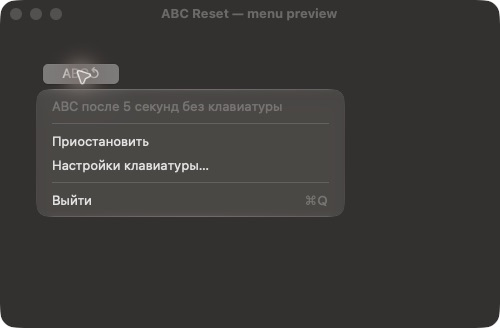

# ABC Reset

**Пять секунд тишины — и снова ABC.**

[![macOS 12+][mac]][plist] [![Swift][swift]][src] [![5 seconds][idle]][policy] [![MIT][mit]](LICENSE)

Вернулся в терминал. Набрал `пше` вместо `git`. Опять раскладка.

ABC Reset подстраховывает в таких паузах: если клавиатура молчит **5 секунд**, приложение переключает
источник ввода на **ABC**. Пока печатаешь, выбираешь раскладку сам — привычными сочетаниями клавиш.
Перестал печатать, отвлёкся, вернулся. Английская уже на месте.

Всё приложение живёт в строке меню. Без отдельного окна, значка в Dock и сторонних зависимостей.



*Меню из кода приложения снято в отдельном окне предпросмотра.
В обычной работе ABC Reset живёт только в строке меню.*

## Как это работает

ABC Reset проверяет состояние клавиатуры каждые **0,25 секунды**. Когда с последнего события прошло
не меньше пяти секунд и ни одна клавиша не удерживается, выбирает `com.apple.keylayout.ABC`.
Переключение происходит при очередной проверке после этого порога, а не по жёсткому таймеру до миллисекунды.

| Что происходит | Как ведёт себя приложение |
| --- | --- |
| Печатаешь или отпускаешь клавишу | Отсчёт начинается заново |
| Двигаешь мышь, листаешь трекпадом | Отсчёт продолжается |
| Удерживаешь клавишу, Shift, Command или другой модификатор | Переключение ждёт отпускания |
| Включён Caps Lock | Сам по себе он не мешает переключению |
| Меняешь раскладку вручную | Получаешь новые пять секунд |
| Запускаешь приложение, снимаешь паузу или будишь Mac | Сначала идут новые пять секунд |
| Текущая раскладка уже ABC | Приложение оставляет её как есть |

Учитываются клавиатуры текущей пользовательской сессии, в том числе внешние USB.
Во время сна и неактивной сессии переключение не выполняется.

Порог фиксированный. Целевая раскладка — именно **ABC**; U.S. и другие английские раскладки её не заменяют.
Приложение не исправляет уже набранные слова и не угадывает язык текста.

## Установка

Понадобятся **macOS 12 Monterey или новее**, Git и **Command Line Tools для Xcode**.
Сейчас приложение устанавливается из исходников.

Если инструментов разработчика ещё нет, выполни команду и дождись завершения установки:

```bash
xcode-select --install
```

Затем скачай проект и собери приложение:

```bash
git clone https://github.com/balyakin/abc-reset.git
cd abc-reset
./build.sh
open "dist/ABC Reset.app"
```

Скрипт создаёт `dist/ABC Reset.app` для архитектуры твоего Mac и подписывает сборку локальной
подписью ad hoc. Swift Package Manager и сторонние пакеты не нужны.

Перенеси приложение в папку «Программы», если хочешь оставить его под рукой. Готово.

Перед первым использованием добавь **ABC** в источники ввода macOS. Открыть нужный раздел можно
из меню приложения: **«Настройки клавиатуры…»**.

### Запуск при входе

Добавь установленное приложение в объекты входа своей учётной записи через настройки macOS.
ABC Reset сам этого не делает — автозапуск остаётся твоим решением.

### Управление

Нажми значок в строке меню:

| Значок | Состояние |
| --- | --- |
| **ABC↺** | Автоматический возврат на ABC включён |
| **ABCⅡ** | Работа приостановлена |
| **ABC!** | Возникла ошибка; подробности — в меню |

В меню можно приостановить переключение, возобновить его, открыть настройки клавиатуры или выйти.
После возобновления приложение снова выжидает пять секунд.

## Приватность

Набранные символы приложению не нужны. Оно запрашивает время последних клавиатурных событий,
состояние клавиш и идентификатор текущего источника ввода через системные API macOS.

В коде нет сетевых обращений, аналитики и записи введённого текста. Нажатия клавиш не имитируются.
Список доступных раскладок приложение тоже не меняет — только выбирает уже включённую ABC.
Ошибки переключения и успешный выбор ABC записываются в системный журнал без содержимого ввода.

## Если что-то пошло не так

**Появился `ABC!`.** Открой меню и прочитай сообщение. Чаще всего нужно добавить ABC в источники ввода.
После ошибки приложение повторяет попытку не чаще одного раза в пять секунд.

**Раскладка не переключается.** Проверь, что приложение не на паузе, отпусти все клавиши
и выжди пять секунд. Ручная смена раскладки тоже запускает отсчёт заново.

**Нет значка в Dock.** Так задумано. Ищи **ABC↺**, **ABCⅡ** или **ABC!** в строке меню macOS.

**Хочется другой интервал или другую раскладку.** Настроек для этого пока нет.
Порог задаётся в [ResetPolicy.swift](Sources/ABCReset/ResetPolicy.swift),
а идентификатор ABC — в [InputSources.swift](Sources/ABCReset/InputSources.swift).

Локальная ad hoc подпись подходит для собственной сборки. Готового дистрибутива с Developer ID
и нотариализацией в этом репозитории пока нет; сборка из исходников — описанный здесь способ установки.

## Проверка работы

Для быстрой ручной проверки выбери любую раскладку, кроме ABC, отпусти клавиши и подожди пять секунд.
Двигать мышь можно. Источник ввода должен смениться на ABC.

### Проверки логики

```bash
./check.sh
```

**14 проверок** покрывают пятисекундный порог, паузу и возобновление, удержание клавиш,
некорректное время простоя, повторный отсчёт, отложенное чтение состояния клавиш и смену раскладки
до доставки системного уведомления. По умолчанию тесты не переключают текущую раскладку.

Проверить доступ к настоящим API клавиатуры и источников ввода:

```bash
KSW_RUN_SYSTEM_TESTS=1 ./check.sh
```

### Проверка запущенного приложения

Сначала собери приложение, закрой уже работающий экземпляр и убедись, что **ABC** и **Русская**
включены в источниках ввода. Затем выполни:

```bash
KSW_RUN_SYSTEM_TESTS=1 \
KSW_LIVE_APP_PATH="$PWD/dist/ABC Reset.app/Contents/MacOS/ABCReset" ./check.sh
```

Этот тест сначала выбирает ABC и запускает приложение, затем временно включает русскую раскладку
и ждёт возврата на ABC. При завершении восстанавливает исходный источник ввода.
Пока тест идёт, не нажимай клавиши.

## Внутри проекта

Swift и встроенные фреймворки macOS: **AppKit**, **Carbon**, **CoreGraphics**, **Foundation** и **os**.

| Файл | За что отвечает |
| --- | --- |
| [Application.swift](Sources/ABCReset/Application.swift) | Меню, таймер, сон, сессия и сообщения об ошибках |
| [KeyboardState.swift](Sources/ABCReset/KeyboardState.swift) | Время простоя и удерживаемые клавиши |
| [InputSources.swift](Sources/ABCReset/InputSources.swift) | Поиск ABC и переключение через Text Input Sources API |
| [ResetPolicy.swift](Sources/ABCReset/ResetPolicy.swift) | Условия переключения и пятисекундный отсчёт |
| [Tests](Tests) | Проверки логики и интеграция с macOS |
| [build.sh](build.sh) / [check.sh](check.sh) | Сборка приложения и запуск проверок |

Нашёл сбой? [Создай issue][issues]: укажи версию macOS, выбранную раскладку и шаги,
после которых поведение расходится с ожидаемым. Предложения и небольшие pull request тоже приветствуются.

## Лицензия

[MIT](LICENSE) · Copyright (c) 2026 [Evgeny Balyakin](https://github.com/balyakin).

[mac]: https://img.shields.io/badge/macOS-12%2B-111111?logo=apple&logoColor=white
[swift]: https://img.shields.io/badge/Swift-native-F05138?logo=swift&logoColor=white
[idle]: https://img.shields.io/badge/keyboard_idle-5_seconds-2563EB
[mit]: https://img.shields.io/badge/license-MIT-16A34A
[plist]: Resources/Info.plist
[src]: Sources/ABCReset
[policy]: #как-это-работает
[issues]: https://github.com/balyakin/abc-reset/issues
